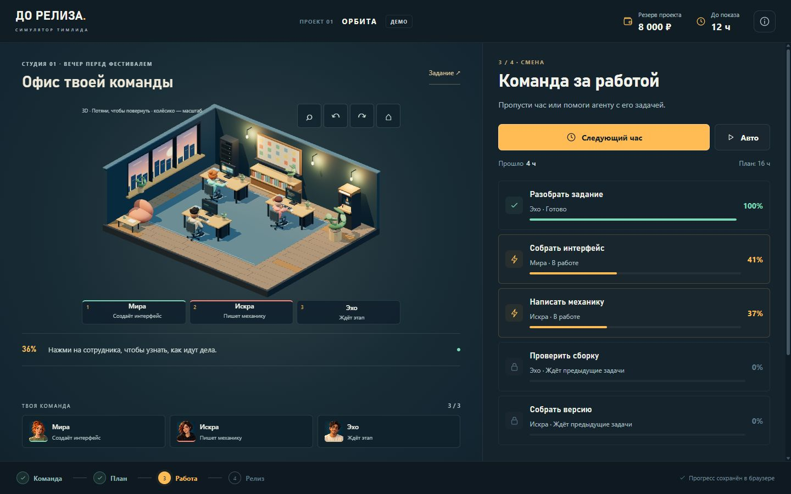
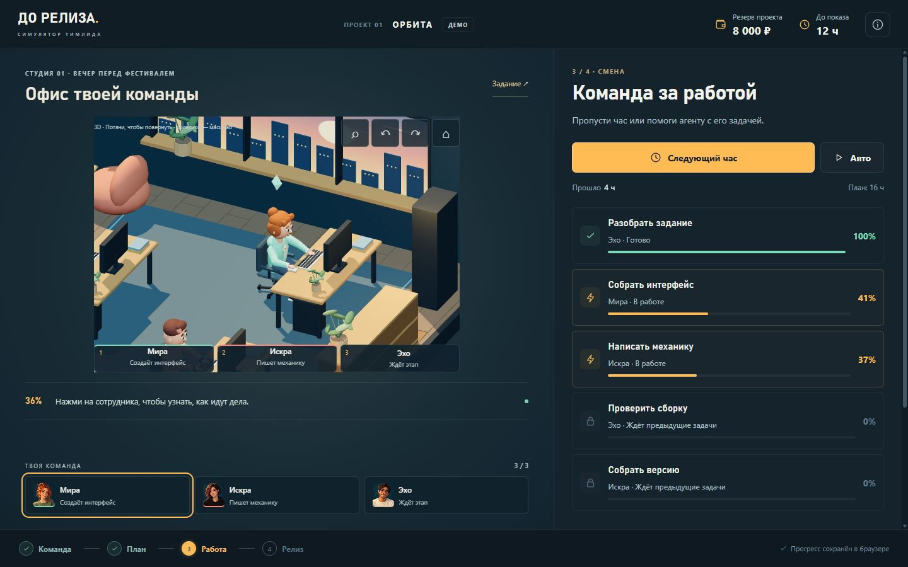

# Офис и персонажи

`do-reliza-office.blend` — редактируемая сцена Blender 5.2: вечерняя студия, три компьютера, кресла, окно, полки, растения, зона отдыха и шесть персонажей. В сцене показаны Мира, Искра и Эхо за рабочими местами; остальные персонажи скрыты справа от комнаты.



Игровые файлы находятся в `assets/models/`: office.glb и шесть отдельных моделей персонажей. В браузере они рисуются Three.js; перемещение, вставание, посадка и печать анимируются игровым кодом через узлы суставов. Это живая 3D-сцена с поворотом и масштабом камеры. Запечённых видеороликов и удалённых генераторов в ней нет.

В 0.5 добавлены кисти с четырьмя отдельными пальцами и большим пальцем, запястья, веки, детали одежды и поворот верхней части тела от пояса. Руки решаются двухзвенной IK к клавиатуре и мыши; обе стопы привязаны к полу с учётом геометрии обуви. Перекат стопы, перенос веса, плавный разгон, остановка и переходы между действиями вычисляются в office-pose.js и office-actors.js. Кресла выделены отдельно и сдвигаются при посадке; стены вместе с декором скрываются со стороны камеры.



В Blender сохранены 19 редактируемых контрольных поз Миры: ходьба 1–31, посадка 50–80, работа 100–130, ожидание 150. Это образцы из настоящего игрового кода для проверки и правки, не готовый видеоролик и не отдельная система движения. Непрерывная анимация браузера использует IK и текущий маршрут. Файл открывается на рабочей позе 100.

## Повторить сборку

Из корня репозитория, в установленном Blender 5.2:

```powershell
& 'C:/Program Files/Blender Foundation/Blender 5.2/blender.exe' --background --factory-startup --python art/blender/build.py
```

Путь Blender на другом ПК может отличаться. Сборка заменяет только коллекцию Release3D_Office и принадлежащие рецепту игровые файлы. Для повторной сборки нужен Blender; для запуска игры достаточно файлов репозитория и статического HTTP-сервера.

Порядок: runner.py → office_recipe.py → characters_recipe.py → export_assets.py. `build.py` выполняет этот порядок. Исходная итерация собрана и проверена через MCP в живом Blender. Рецепты сохраняют размеры и имена узлов, которыми пользуется браузер. Не менять размеры столов и расположение мебели без одновременного обновления office-layout.js.

После изменения анимации выполнить `node scripts/bake-motion-preview.js`, затем применить `motion_preview.py` через MCP либо повторить Blender-сборку. `motion-preview.json` содержит позиции в Blender Z-up и кватернионы wxyz; glTF экспортирует все узлы в Y-up. Игровой код должен менять высоту через position.y, а не position.z. Проверки загружают настоящие GLB и выявляют ошибки этой конвертации.

## Контактные поверхности

- Пол: z=0, ковёр выступает на 3 мм. Верх основания ниже пола на 25 мм, доски не пересекаются.
- Стол: верх .80 м, низ .72 м; ножки заканчиваются на .72 м.
- Кресло: верх сиденья .48 м.
- Клавиатура: верх клавиш .838 м; запястья при печати около .864 м. Мышь приближена к переднему краю стола; запястье около .870 м. Ладонь и пальцы направлены к поверхности, а не висят вертикально.
- Персонаж: таз .88 м стоя, .60 м сидя; низ одежды таза находится на .48 м. Угол бедра acos(.3), голень развёрнута обратно; подошва достигает пола.
- Монитор: экран утоплен в рамку, UV-плоскость имеет отдельную метку screenIndex.

Контакты и шесть ортографических видов рабочего места проверены до размножения мебели. Все итоговые mesh datablock однопользовательские. Статическая мебель объединена по материалам; суставы персонажей оставлены отдельными.

## MCP

На основном ПК установлен MCP for Blender 2.2.4 и дополнение протокола 15, подключённые к Blender 5.2 на loopback-порту 9876. Проверены handshake и чтение сцены. Настройка Codex добавлена глобально; дополнение автоматически запускает локальный сервер вместе с Blender. Обычный перезапуск Codex нужен для обновления встроенного списка инструментов, если тот ещё не перечитан. Файлы конфигурации и резервные копии настроек не входят в репозиторий.

На втором ПК MCP устанавливается отдельно по документации проекта: https://github.com/ahujasid/mcp-for-blender. Он нужен для редактирования, а не для игры. Платные генераторы и внешние библиотеки ассетов в этой сборке не использовались.

`build-receipt.json` фиксирует версии, размеры, хеши и параметры проверки. Скриншоты контроля остаются локально в outputs/.
