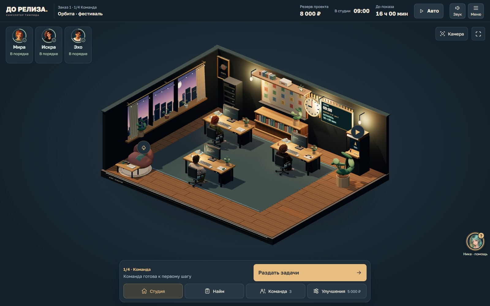
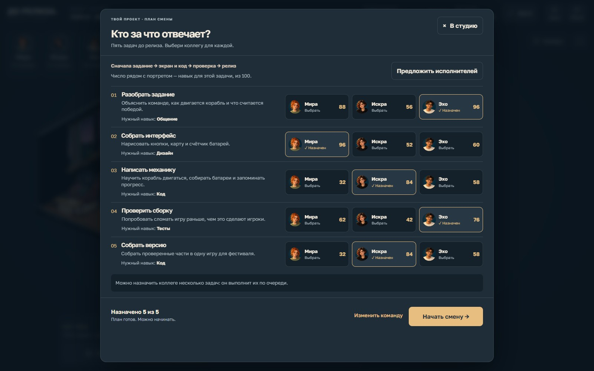

# Кадры для презентации

Реальные снимки игры, сделанные 25 октября 2026 в Chromium. Их можно вставлять в слайды как обычные изображения. Обзор и план выступления — в [PRESENTATION.md](../PRESENTATION.md).

| Файл | Что показать на слайде |
|---|---|
| [01-start.jpg](screenshots/01-start.jpg) | Название, профессия тимлида, понятный вход и выбор сложности |
| [02-office.jpg](screenshots/02-office.jpg) | Интерактивная вечерняя 3D-студия с командой за рабочими местами |
| [03-employee.jpg](screenshots/03-employee.jpg) | Состояние сотрудника: энергия, настроение, напряжение и помощь |
| [04-planning.jpg](screenshots/04-planning.jpg) | Пять задач, зависимости и назначение по профильным навыкам |
| [05-planning-mobile.jpg](screenshots/05-planning-mobile.jpg) | Мобильный интерфейс: выбор по портретам и доступная кнопка начала смены |
| [06-model-inspection.jpg](screenshots/06-model-inspection.jpg) | Осмотр настоящего предмета из офиса, сравнение улучшения и прозрачная цена покупки |
| [07-conversation.png](screenshots/07-conversation.png) | Контекстные разговоры сотрудников прямо в 3D-сцене |
| [08-decision.jpg](screenshots/08-decision.jpg) | Мнения команды и варианты технического решения; пример ограничения при нулевом резерве |
| [09-team-reaction.jpg](screenshots/09-team-reaction.jpg) | Последствия выбора и разные реакции коллег |
| [10-orbit.jpg](screenshots/10-orbit.jpg) | Выпущенная мини-игра: поле, управление, оборудование и сохранение |
| [11-orbit-mobile.jpg](screenshots/11-orbit-mobile.jpg) | «Орбита» на мобильном экране, одна батарея уже собрана |
| [12-release.jpg](screenshots/12-release.jpg) | Пример реального прохождения: релиз 93/100, срок, резерв и доход студии |

Кадр разговора снят в опубликованной версии при проверке озвучки. Кадры 08–11 взяты из браузерной проверки интерфейса, принятого в PR #54; в 08 специально проверяется ситуация с нулевым резервом. Остальные — из локальной производственной сборки. Точные ревизии или ревизии принятия изменений, версии ассетов для собранных версий, размеры и SHA-256 сохранены в [receipt.json](screenshots/receipt.json). Снимок фиксирует состояние игры в момент съёмки. Значения кассы, навыков и наград зависят от сложности и прохождения.

Для основного рассказа достаточно общего вида студии, планирования, технического решения и выпущенной «Орбиты». Разговор и осмотр улучшения показывают дополнительные возможности. Мобильный кадр удобно поставить рядом с настольным, сохранив его пропорции. Подробный перечень возможностей лучше оставить для устного пояснения.

